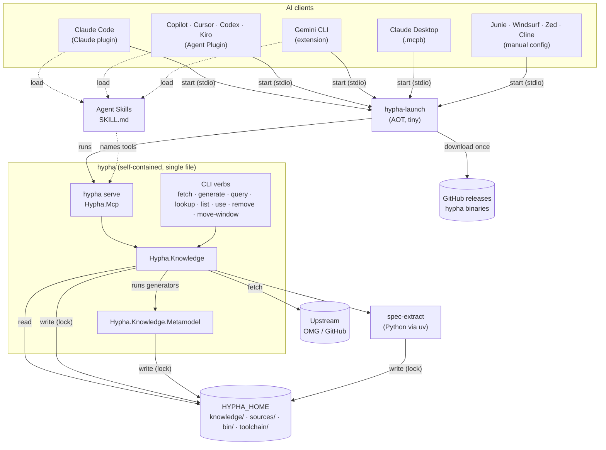
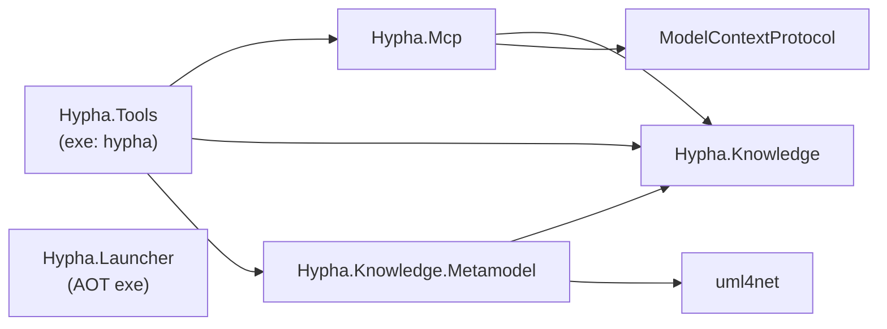
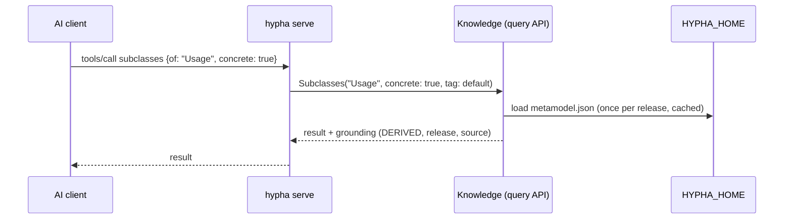
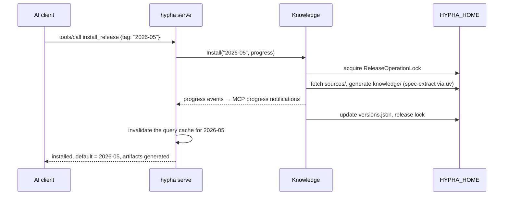

# Hypha as an MCP server

Goal: one implementation of Hypha for every AI client (Claude, GitHub Copilot, Cursor, …), exposed in one aligned way.

Decision: all knowledge (metamodel, grammar, cross-references, model library, spec text) is generated locally on the user's machine. Nothing generated is distributed.

---

## 1. Target architecture

### 1.1 Principles

1. **One binary**: a single `hypha` executable per platform, holding the CLI verbs and the MCP server (`hypha serve`). Writes run in-process; there is no second process to provision or keep in sync.
2. **One interface for AI clients**: the MCP server. No client talks to the CLI, the files or `jq` directly.
3. **Two portable layers**: the MCP server holds the capability (tools, resources, prompts); Agent Skills (`SKILL.md`) hold the procedure. Skills call MCP tools only.
4. **Read and write separated in code**: one `Hypha.Knowledge` library, with reading (layout, inventory, lookup, query API) kept apart from writing (fetch, generation, install / use / remove) by namespace. Reading code never calls the write path. A namespace boundary, not a project or process boundary.
5. **Safe concurrent writers**: every client starts its own server, so writes to the shared location go through one cross-process `ReleaseOperationLock`, and readers detect changes made by other processes.
6. **One knowledge location** per user (`HYPHA_HOME`), shared by every client.
7. **Shared contracts**: generators and readers use the same C# types for every JSON artifact.
8. **Clients are packaging only**: one repo carries every client manifest over the same `skills/` and the same `hypha-launch`; no client-specific logic.
9. **Tools first**: every capability works through tools plus server `instructions`, because some clients never load skills, resources or prompts.
10. **Local only**: all clients run `hypha` on the user's machine over stdio. Web-only clients that need a remote server are out of scope.

### 1.2 Why one binary, not AOT server + CLI

- An MCP server is long-lived (started once per session), so AOT's main benefit, startup time, barely matters.
- A self-contained single-file .NET build needs no installed runtime, just like AOT.
- The generators (uml4net, Handlebars) are not AOT-compatible, and they must run on the user's machine. One non-AOT binary avoids a second process, a JSON contract between processes and a version pin between them.
- Cost: a larger download (tens of MB per platform). Users would download the generators anyway on their first release install.

### 1.3 Components

| Component | Kind | Role |
| --- | --- | --- |
| `Hypha.Knowledge` | Library | Reading: layout, inventory, contracts and typed readers, lookup, query API, search, grounding. Writing: discovery, fetch, generator orchestration, install / use / remove, `ReleaseOperationLock` |
| `Hypha.Knowledge.Metamodel` | Library | XMI → metamodel artifacts (uml4net, Handlebars) |
| `Hypha.Mcp` | Library | MCP tools, resources, prompts, instructions over `Hypha.Knowledge` |
| `Hypha.Tools` | Executable `hypha` | Hosts everything: CLI verbs + `hypha serve` |
| `Hypha.Launcher` | Executable `hypha-launch` (AOT, tiny) | The single entry point for every plugin format and the `.mcpb` bundle: downloads the matching `hypha` once, then runs `hypha serve` (replaces today's hook) |
| `spec-extract` | Python | Spec PDFs → `spec/` text; run by `Hypha.Knowledge` via uv |
| Agent Skills | Markdown | Grounding discipline, version choice, when to cite vs reason |
| Client packages | Packaging | Claude plugin, VS Code extension, Cursor config |

Naming: the two knowledge libraries share the `Hypha.Knowledge` namespace root. `Hypha.Knowledge` reads, produces and manages the knowledge; `Hypha.Knowledge.Metamodel` (previously `Hypha.MetamodelGen`) generates the metamodel from XMI.

Why one knowledge library and not a read project plus a write project: a split was built in step 1 and then dropped. Its main benefit, a read side that an AOT host could link without the generators, has no consumer: `hypha` is one non-AOT binary (section 1.2), the launcher references nothing in the repo, and `Hypha.Mcp` and `Hypha.Tools` need both halves anyway. Every write-side component also reads (the installers read `versions.json`, the cross-reference generator reads the index), so the split cost a project boundary to maintain without protecting anything. Read and write stay apart by namespace instead. Revisit only if a read-only consumer appears (see the last note at the end).

Retired: `Hypha.Tools.Hook` (`hypha-hook`), `hooks/native/`, the three agents, the VS Code extension's own `vscode.lm` tools, `jq`.

### 1.4 Component diagram



### 1.5 Project dependencies



Rules:

- `Hypha.Knowledge` depends on nothing in the repo, and on neither uml4net nor Handlebars. `Hypha.Knowledge.Metamodel` references it (for `IKnowledgeGenerator`, the layout and the metamodel contracts), never the reverse; `Hypha.Tools` registers the metamodel generators into the same collection at startup.
- Inside `Hypha.Knowledge`, reading code (layout, inventory, lookup, query API) makes no network calls and never calls the write path.
- `Hypha.Mcp` is a library; the executable that hosts it is `hypha`. CLI verbs and MCP tools call the same `Hypha.Knowledge` methods, so they return identical answers by construction.
- `Hypha.Launcher` references nothing else in the repo.

### 1.6 Runtime flows

**Read (most requests)**



**Write (install a release), in-process**



**Another client changed the knowledge**

1. A second server (e.g. VS Code while Claude Code is open) installs or switches a release.
2. The query API notices `versions.json` changed (timestamp check on each request, or a file watcher) and drops its cached inventory and releases.

**Session start (replaces the SessionStart hook)**

1. The client starts the server (directly, or through `hypha-launch`). At `initialize` the server sends its `instructions` (grounding rules).
2. The model calls `release_status` when a skill or the user needs it. If nothing is installed, it offers `install_release`. No hook, no shell.

### 1.7 Reading in `Hypha.Knowledge`

Read-only, no network, source-generated JSON, thread-safe. Loads each release lazily once and caches it.

1. **Layout and path resolution**: today's `Layout/` (`KnowledgeLayout`, `ReleaseArtifacts`, `ReleaseStatus`); resolves `HYPHA_HOME`.
2. **Release inventory**: reads `knowledge/versions.json` and `knowledge/api/versions.json`: installed releases and API versions, the default, which artifacts are generated. Detects changes by other processes.
3. **Typed contracts and readers**: shared DTOs and JSON contexts for `metamodel.json`, `cross-references.json`, the model-library `index.json`, and the API cross-references and PIM. The generators write these same types.
4. **Paged lookup**: today's `Lookup/` (`KnowledgeLookup`, `DeclarationLocator`).
5. **Query API** (the jq replacements): subclasses (concrete or not), classes with a feature typed T, origin of an inherited attribute, redefinitions, cross-reference clauses / grammar productions / feature assignments per element, reverse lookup feature → productions, model-library declarations, API types and operations.
6. **Spec text access**: clauses in `knowledge/<tag>/spec/` for citation, with an explicit "not generated" status.
7. **Search and addressing**: name/kind search; build, parse and resolve `hypha://{tag}/{kind}/{name}` only through the index.
8. **Grounding metadata**: NORMATIVE (spec text), MODEL (metamodel) or DERIVED (closures, cross-references), plus release and source location, on every result.

Stays out: discovery, fetch, generation, every write. Validation reasoning stays in the skill; the query API supplies the facts.

### 1.8 Writing in `Hypha.Knowledge`

As today, plus:

- Installer operations report progress through an `IProgress<T>` that both the CLI (console output) and the MCP server (progress notifications) consume.
- `ReleaseOperationLock` is a cross-process lock on `HYPHA_HOME`, since several servers and the CLI can run at once.
- Defaults to `HYPHA_HOME`; checkout mode and `--output` stay for maintainers.

### 1.9 `Hypha.Mcp` and `hypha serve`

Official `ModelContextProtocol` C# SDK, stdio transport, attribute-based with explicit `WithTools<T>()` / `WithResources<T>()` / `WithPrompts<T>()` registration. Logs to stderr only.

- **Tools** (primary surface; every client supports them). All prefixed `hypha_`, about 10–15 in total (Windsurf caps all servers combined at 100 tools):
  - query API tools (group related queries behind one tool with a `kind` argument where it keeps the count down)
  - `hypha_lookup` (paged)
  - `hypha_search_spec` → `hypha://` URIs
  - `hypha_release_status`
  - `hypha_install_release`, `hypha_use_release`, `hypha_remove_release` (in-process, with progress)
- **Resources**: template `hypha://{tag}/{kind}/{name}` over lookup pages. Everything is also reachable through a tool, since client support for resources is uneven.
- **Prompts**: guided flows from `commands/overview.md` and common questions.
- **`instructions`**: the NORMATIVE / MODEL / DERIVED grounding rules and a short "which tool when" guide. This is the only guidance clients without skills (Claude Desktop, Zed, Windsurf) get, so it must be enough on its own.

### 1.10 `hypha` executable

- CLI verbs: `discover`, `fetch`, `generate`, `list`, `lookup`, `query …` (new), `use`, `remove`, `check`, `move-window`, `api …`, and `serve` (new).
- Build: self-contained, single-file, per RID (win-x64, linux-x64, linux-arm64, osx-x64, osx-arm64). Not trimmed, because uml4net and Handlebars use reflection. ReadyToRun to shorten startup.
- Also published as a .NET tool (`PackAsTool`) for .NET users.

### 1.11 `Hypha.Launcher` (`hypha-launch`)

The single entry point every client starts. Plugin packages are git repositories or zip archives, so they can carry a tiny AOT launcher but not a `hypha` of tens of MB per platform.

- Contains today's `CliProvisioner`, `ChecksumTable`, `CacheLayout` and `GitHubRelease`.
- On start: ensure the `hypha` version matching the package version is in `HYPHA_HOME/bin/<version>/` (download + checksum on first run), then run `hypha serve` with stdio passed through.
- No contract beyond "start this exact version": the launcher and `hypha` come from the same release.
- **Platform dispatch from one path**: an `mcp.json` entry is a single command with no `uname` switch. Ship `bin/hypha-launch.exe` (Windows, found from the extensionless path) and a POSIX `bin/hypha-launch` script that execs `bin/<rid>/hypha-launch` for macOS and Linux. Must be tested in every client.
- **Never depends on client path variables** (`${PLUGIN_ROOT}`, `${CLAUDE_PLUGIN_ROOT}`, `${extensionPath}`, `${__dirname}`): it resolves its own location and `HYPHA_HOME` itself.
- **Network failures are explicit**: if the first download is blocked (offline, proxy, a client sandbox such as Codex's `network_access`), the launcher still starts a minimal MCP server whose only tool, `hypha_status`, explains what is blocked and how to fix it. The model can tell the user instead of the server silently failing.
- Honours `HTTPS_PROXY` and a `HYPHA_BIN` override (pre-installed `hypha`, for offline or locked-down machines).

### 1.12 Data: `HYPHA_HOME`

One per-user directory, overridable with `HYPHA_HOME`. It replaces today's split between the Claude plugin root and VS Code extension global storage.

```
HYPHA_HOME/
├── knowledge/
│   ├── versions.json            default + installed language releases
│   ├── <tag>/                   metamodel/, textual-notation/, cross-references.json, model-library/, spec/
│   └── api/
│       ├── versions.json
│       └── <version>/
├── sources/                     fetched upstream inputs
├── bin/<version>/               hypha binaries provisioned by hypha-launch
├── toolchain/                   uv + Python for spec-extract
└── .lock                        ReleaseOperationLock
```

Schemas for `metamodel.json`, `cross-references.json`, `model-library` and API cross-references stay committed in the repo.

### 1.13 Contracts

| Contract | Between | Defined in |
| --- | --- | --- |
| Knowledge artifact JSON + schemas | Generators ↔ readers | `Hypha.Knowledge` DTOs and their source-generated contexts + `knowledge/*.schema.json` |
| MCP tool names, arguments, results | Server ↔ AI clients and skills | `Hypha.Mcp` |
| `hypha://{tag}/{kind}/{name}` | Resources, `search_spec` | `Hypha.Knowledge` |
| Grounding tags | Every answer | Query API result types; rules in `instructions` and skills |
| CLI `--json` output | `hypha` ↔ scripts and the VS Code extension's commands | `Hypha.Knowledge` result types |
| Launcher → `hypha` version | `hypha-launch` ↔ `hypha` | Same release version |
| Client manifests | Repo ↔ each client | Generated from one source in CI (section 1.14) |

### 1.14 Packaging: one repo, three manifests, one bundle

Agent Plugins 1.0 (August 2026) is the portable packaging standard (root `plugin.json` with `$schema`, `skills/`, `mcp.json`). Claude Code and Gemini CLI keep their own formats. All manifests share the same `skills/` and `bin/hypha-launch`.

```
mycelium-hypha/
├── plugin.json                  Agent Plugins 1.0 manifest
├── mcp.json                     Agent Plugins MCP config → bin/hypha-launch
├── .claude-plugin/
│   ├── plugin.json              Claude Code manifest
│   └── marketplace.json         (also read by Copilot CLI)
├── .mcp.json                    Claude Code MCP config → bin/hypha-launch
├── gemini-extension.json        Gemini CLI manifest (mcpServers → bin/hypha-launch)
├── skills/                      shared Agent Skills
├── bin/
│   ├── hypha-launch             POSIX dispatch script
│   ├── hypha-launch.exe         Windows launcher
│   └── <rid>/hypha-launch       macOS / Linux launchers
└── …                            sources, tools, tests (as today)
```

Release assets (not committed): self-contained `hypha` per RID, and `hypha-<version>-<rid>.mcpb` per platform for Claude Desktop (`server.type = "binary"`, entry point `hypha-launch`).

The three manifests and two MCP configs are generated from one source of truth (name, version, description, server command) in CI, and a check fails the build if they drift.

### 1.15 Clients and deployment

| Client | Package | Install | Skills | Notes |
| --- | --- | --- | --- | --- |
| Claude Code | Claude plugin | `/plugin marketplace add` + install | Yes | Not an Agent Plugins client |
| VS Code + Copilot | Agent Plugin | Plugin marketplace | Yes | Also reads Claude-format plugins |
| Copilot CLI / Copilot app | Agent Plugin | `copilot plugin install` | Yes | |
| Copilot cloud agent | Agent Plugin | `enabledPlugins` in `.github/copilot/settings.json` | Yes | Fresh environment per run: first `install_release` runs every time |
| Cursor | Agent Plugin | Marketplace or team marketplace | Yes | |
| OpenAI Codex (CLI, IDE, ChatGPT desktop) | Agent Plugin | `/plugins` | Yes | Sandbox may block network; check `network_access` |
| AWS Kiro | Agent Plugin | Plugin install | Yes | |
| Gemini CLI | Gemini extension | `gemini extensions install <repo url>` | Yes | |
| Claude Desktop | `.mcpb` bundle | Double-click | No | Relies on `instructions` |
| JetBrains Junie / AI Assistant | Manual config | `~/.junie/mcp/mcp.json`, skills in `~/.junie/skills/` | Yes (copied) | Optional later: small JetBrains plugin that writes both |
| Windsurf | Manual config | `mcp_config.json` | Unconfirmed | 100-tool cap across all servers |
| Zed, Cline, Roo | Manual config | Client settings | Weak / none | Tools only; relies on `instructions` |
| claude.ai web, ChatGPT web | n/a | n/a | n/a | **Out of scope**: remote servers only |

Manual-config clients get a documented snippet pointing at the launcher from the release archive.

**VS Code extension**: VS Code installs Agent Plugins natively, so the plugin covers Copilot. The extension is kept only if its Marketplace listing and install UI add value; otherwise it is retired. If kept, it contains no tools of its own and registers the same launcher.

No client contains its own tools, agents, hooks or `jq` instructions.

### 1.16 Alignment and verification

- One repo; one version number for `hypha`, the launcher, skills and every manifest.
- Manifest drift check: the three manifests and two MCP configs match their single source.
- Client smoke-test matrix: for each client in section 1.15, install the package, confirm the launcher starts on win-x64, linux-x64 and osx-arm64, and call `hypha_release_status`.
- Golden tests: query API output equals the documented jq queries on a fixture release.
- CI lint: every tool name a skill mentions exists in the server.
- Stdio integration test: SDK client ↔ `hypha serve` against a fixture knowledge base.
- Concurrency test: two processes installing / switching at once, readers see consistent state.
- `dotnet test` leaves the working tree clean (existing rule).

---

## 2. Steps to get there

Current state: the Claude plugin (6 skills, 3 agents, SessionStart hook, ad-hoc `jq`) and the VS Code extension (two TypeScript `vscode.lm` tools shelling out to the CLI) expose Hypha in two separate ways that drift apart. Knowledge lives in the plugin root or in VS Code global storage.

### Step 1: Prepare the knowledge libraries

- [x] Rename `Hypha.MetamodelGen` to `Hypha.Knowledge.Metamodel` (projects, namespaces, test projects, solution, CI paths, READMEs, `CLAUDE.md`).
- [x] Serialize every knowledge JSON document through a source-generated `JsonSerializerContext`, next to its DTOs in `Hypha.Knowledge`.
- [x] Move the DTOs written by `MetamodelJsonGenerator` into `Hypha.Knowledge`, so reading `metamodel.json` needs neither the generator nor uml4net.
- [x] Add the missing `knowledge/metamodel.schema.json`.
- [x] Keep `dotnet test` green and the working tree clean.
- Dropped: splitting `Hypha.Knowledge` into `Hypha.Knowledge.Query` and `Hypha.Knowledge.Build`. It was built and reverted; see the naming note in section 1.3.

### Step 2: Build the query API

- [x] Collect every jq example from `skills/metamodel-lookup`, `skills/sysml-validation`, `skills/spec-citation`, `skills/api-lookup`, `skills/model-library-lookup`, `agents/metamodel-navigator.md` and `tools/metamodel-gen/README.md` (24 queries).
- [x] Group them into roughly ten methods (section 1.7): `IKnowledgeQuery` for a release, `IApiQuery` for an API version, in `Hypha.Knowledge.Query`.
- [x] Grounding metadata (tier, release, source file) on every result, and change detection: each document is read again when its file changes, and the manifests are read on each access.
- [x] Golden tests: on a fixture release, C# output equals jq output (`KnowledgeQueryJqTests`; required in CI through `HYPHA_REQUIRE_JQ`, skipped locally without jq).
- [x] Give `MetamodelJsonContext` the camel-case naming policy, so `metamodel.json` and `index.json` read back through it.
- [x] Add spec text access (`Clause`, with an explicit `Unavailable` when the PDFs were never processed), and search / `hypha://` addressing (`Search`, `HyphaAddress`, `Resolve`).
- [x] Report which artifacts each installed release has generated in the release inventory (section 1.7, item 2).
- [x] Validation and citation queries beyond the documented jq: ancestors and specialization, constraints and operations, enumeration literals, subsettings, the elements a production builds or a clause treats.
- Deferred: a keyword query (#205), which needs the keyword index as JSON, and a diff between two releases (#206).

### Step 3: Prepare the write path and the CLI

- [ ] Rewrite `lookup` and `list` over the query API; add `hypha query …` verbs.
- [ ] Add `IProgress<T>` reporting to install / fetch / generate.
- [ ] Make `ReleaseOperationLock` cross-process safe; add the concurrency test.
- [ ] Make `HYPHA_HOME` the default location; keep checkout mode and `--output` for maintainers.

### Step 4: Add `Hypha.Mcp` and `hypha serve`

- [ ] Create the `Hypha.Mcp` library: tools, resources, prompts and `instructions` (section 1.9), with progress notifications for writes.
- [ ] Add the `serve` verb to `hypha`.
- [ ] One-time migration of existing plugin and VS Code installs into `HYPHA_HOME`.
- [ ] Stdio integration test against a fixture knowledge base.

### Step 5: Make the skills portable

- [ ] Rewrite the six skills to call MCP tools: no jq, no file paths, no Claude-specific tool names.
- [ ] Fold the three agents (`metamodel-navigator`, `spec-citation`, `sysml-validator`) into skills.
- [ ] Replace `version-management` with the release tools.
- [ ] Add the CI lint for tool names.

### Step 6: Build `Hypha.Launcher`

- [ ] Move `CliProvisioner`, `ChecksumTable`, `CacheLayout` and `GitHubRelease` out of `Hypha.Tools.Hook` into `Hypha.Launcher` (AOT).
- [ ] Download + verify the matching `hypha` into `HYPHA_HOME/bin/<version>/`, then run `hypha serve` with stdio passed through.
- [ ] Resolve its own location and `HYPHA_HOME`; never rely on client path variables.
- [ ] Platform dispatch: `bin/hypha-launch.exe` plus a POSIX `bin/hypha-launch` script that execs `bin/<rid>/hypha-launch`.
- [ ] Fallback mode: when the download is blocked, serve a minimal `hypha_status` tool that explains the cause and fix.
- [ ] Support `HTTPS_PROXY` and a `HYPHA_BIN` override.

### Step 7: Package for every client

- [ ] **Single source of truth** for name, version, description and server command; generate the manifests from it in CI, with a drift check.
- [ ] **Agent Plugins 1.0**: root `plugin.json` (with `$schema`) and `mcp.json` → `bin/hypha-launch`, sharing `skills/`. Covers Copilot (VS Code, CLI, app, cloud agent), Cursor, Codex and Kiro.
- [ ] **Claude plugin**: `.claude-plugin/plugin.json` and `.mcp.json` → `bin/hypha-launch`; ship the skills; remove the SessionStart hook, `hooks/native/` and the README's "Recommended: jq" section.
- [ ] **Gemini CLI**: `gemini-extension.json` with `mcpServers` → `bin/hypha-launch`, sharing `skills/`.
- [ ] **Claude Desktop**: per-platform `.mcpb` (`server.type = "binary"`, entry point `hypha-launch`) as a release asset.
- [ ] **Manual-config clients** (Junie, Windsurf, Zed, Cline, Roo): document a config snippet per client, plus where to copy the skills.
- [ ] **VS Code extension**: decide keep or retire. If kept: delete the two `vscode.lm.registerTool` tools, register the same launcher, ship no tools of its own.
- [ ] Keep tools at about 10–15, all prefixed `hypha_`; make `instructions` sufficient on their own for clients without skills.

### Step 8: CI and release

- [ ] Build self-contained single-file `hypha` per RID as GitHub release assets.
- [ ] Replace `hook-binaries.yml` with a workflow that builds and commits the per-RID `hypha-launch` and the dispatch script.
- [ ] Build the `.mcpb` bundles per platform as release assets.
- [ ] One version across `hypha`, launcher, skills and every manifest; plugin 3.0.0 (agents, hook and jq removed is breaking).
- [ ] Remove `Hypha.Tools.Hook`.

### Step 9: Verify across clients

- [ ] Run the smoke-test matrix (section 1.16): install, launcher start on win-x64 / linux-x64 / osx-arm64, `hypha_release_status`, one query, one `hypha_install_release`.
- [ ] Confirm the platform dispatch works in each client (extensionless path on Windows, script on POSIX).
- [ ] Check Codex's sandbox with and without `network_access`; confirm the fallback message reaches the user.
- [ ] Check Windsurf's tool count with Hypha alongside other servers.
- [ ] Check Copilot cloud agent install time in a fresh environment; document it.

### Step 10: Deprecate jq

- [ ] Keep jq as a documented fallback for one minor release.
- [ ] Watch real sessions; promote questions that still fall through to jq into query methods.
- [ ] Remove jq.

### Notes

- Steps 1–3 are the real refactor and carry most of the risk; the rest is mostly assembly.
- The Lookup and Layout code was only skimmed; some changes may surface when it moves.
- Retiring the hook removes the Git Bash requirement on Windows.
- Open risks to settle early: platform dispatch from a single `mcp.json` path, and client network sandboxes. Prototype the launcher in two or three clients before steps 4–5 are finished.
- Client support was checked in November 2026; formats move fast, so re-check before release.
- If the single binary turns out too large or too slow to start, revisit: an AOT `hypha serve` for reads only, with writes delegated to the full binary. That read-only server is also the consumer that would justify splitting the reading code out of `Hypha.Knowledge` into its own AOT-compatible project; the namespace boundary of principle 4 keeps that split mechanical.
